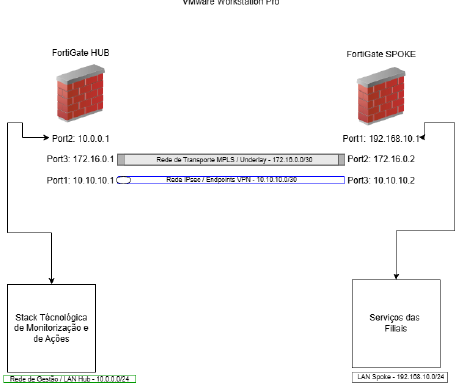
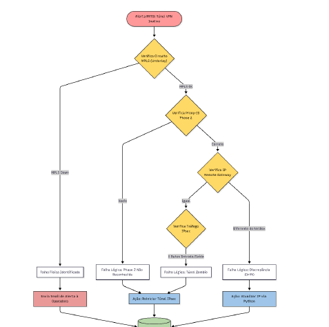
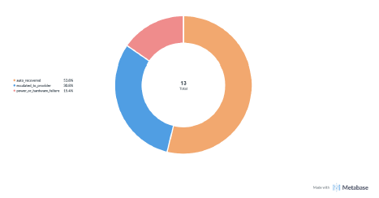

# NetDevOps Closed-Loop Active Self-Healing Platform

<p align="left">
  
  
  
  
  
  
  
  
  
  
</p>

> **Automação e Inteligência em Redes de Comunicação de Dados: integração da metodologia Network DevOps (NetDevOps), numa arquitetura de redes híbrida (Projeto I & Projeto II · Nota Final: 19 / 20)**  
> Event-driven closed-loop network automation prototype developed in collaboration with **ARTE, I.P.** (*Agência para a Reforma Tecnológica do Estado, I.P.* — Decreto-Lei n.º 96/2025, ex-AMA) for hybrid Hub-and-Spoke WANs (**Overlay IPsec IKEv2 VPN over Underlay MPLS**). Evaluated across **10 Chaos Engineering scenarios (A–J)** and **24 recorded laboratory incidents** (`13` in Phase 1 `incident_runs` + `11` in Phase 2 `incident_runs_enterprise`), demonstrating **MTTD < 10s** (>95% reduction in Projeto I; **< 1s** via webhooks in Projeto II Phase 2) and **4–7 seconds active remediation & tunnel convergence** documented in FortiOS v7.6.4 syslogs (compared to 15–30 minutes manual troubleshooting).  
> 📄 **Official Academic Reports (Full PDFs):** [**Projeto 1 — Fev 2026 (61 pp.)**](docs/reports/Relatorio_Projeto_1_NetDevOps_ARTE_Fev2026.pdf) &nbsp;|&nbsp; [**Projeto 2 — Jun 2026 (110 pp.)**](docs/reports/Relatorio_Projeto_2_NetDevOps_ARTE_Jun2026.pdf)

---

## 🛠️ Tech Stack

* **Orchestration & Decision Engine:** `n8n` (Deterministic state machine with polling in Phase 1 & real-time HTTP Webhooks in Phase 2)
* **Single Source of Truth (SSoT):** `NetBox` (IPAM / DCIM canonical state reconciliation for MPLS circuits, Remote Gateways, and Phase 2 CIDR selectors)
* **Target Network Hardware & API:** `Fortinet FortiGate NGFW (FortiOS v7.6.4 REST API CMDB)`
* **Phase 1 Contingency Execution:** `Python 3` + `Netmiko` + `ipaddress` (`remediate_config.py`, `remediate_phase2.py`, `remediate_tunnel.py` isolated in `/opt/venv_netmiko` under **Ubuntu Server 24.04 LTS PEP 668**)
* **Monitoring & Triggers:** `Paessler PRTG Network Monitor` (SNMP/ICMP sensors & automated HTTP webhook payloads)
* **Data Persistence & Forensic Audit:** `MongoDB` (Containerized NoSQL store with `incident_runs` and `incident_runs_enterprise` collections aligned with ISO 27001 traceability principles)
* **Business Intelligence & SRE Analytics:** `Metabase` (Root-cause, severity, and MTTR governance dashboards)
* **Alerting & Escalation Channels:** `Telegram Bot API` (Engineering/SRE ChatOps alerts) & `SMTP / Mailtrap` (Automated carrier outage escalation)
* **Hypervisor & Infrastructure Packaging:** `VMware Workstation Pro (25H2)`, `Ubuntu Server 24.04 LTS`, `Docker` & `Docker Compose`

---

## 🔥 Key Highlights & Architectural Progression

* 🔍 **Projeto I (Feb 2026 — Assisted Granular Diagnostics):** Replaced manual SNMP/CLI triage with automated differential diagnostics (`PRTG` + `NetBox SSoT` + `n8n` + `FortiOS GET API` + `Telegram`), isolating physical MPLS drops from logical Phase 2 (`0.0.0.0`), Remote Gateway, and "Zombie Tunnel" (`0 bytes`) failures in **< 10 seconds** (>95% MTTD reduction).
* 🛡️ **Projeto II · Phase 1 (Trial Environment / Netmiko SSH Contingency):** Overcame FortiGate-VM evaluation license REST API write blocks by orchestrating isolated Python/Netmiko scripts over SSH (`/opt/venv_netmiko`, PEP 668) paired with a shell **Pre-Check ICMP probe** (`exitCode` validation on SPOKE WAN `172.16.0.2`) to suppress futile writes during branch power outages.
* ⚡ **Projeto II · Phase 2 (Enterprise Environment / Native FortiOS REST API):** Leveraged commercial FortiGate licenses provided by **ARTE, I.P.** to replace CLI terminal emulation with synchronous **HTTPS `PUT`/`POST` operations** directly against `/api/v2/cmdb/` (API Token + Trusted Hosts `10.0.0.60`), achieving transactional efficiency $\mathcal{R}_{\text{trans}} \ge 90\%$ (< 2s CMDB injection) and extending compliance auditing to **Firewall Security Policies (`policy_disabled`)**.
* 🧪 **Empirical Validation (10 Scenarios A–J & 24 MongoDB Incidents):** Full laboratory validation documented with FortiOS syslogs and n8n traces in [`docs/empirical_lab_validation.md`](docs/empirical_lab_validation.md), complemented by an offline 24-scenario synthetic telemetry generator (`scripts/chaos_simulation_demo.py`) for local container evaluation.

---

## 🏛️ Lab Network Topology & VMnet Segmentation

The virtualized testbed was deployed on **VMware Workstation Pro** across four isolated virtual networks (`VMnets`) to replicate a carrier-grade Hub-and-Spoke government WAN (Sede **HUB** ↔ Loja do Cidadão **SPOKE**) with strict **Out-of-Band (OOB) management segregation**:

<p align="center">
  
</p>

### 🔌 Interface, VMnet & Static Routing Matrix

* **🛡️ VMnet2 — Management Network (OOB LAN `10.0.0.0/24`):** Hosts `FGT-HUB port2` (`10.0.0.1/24`), Windows PRTG Server (`10.0.0.50/24`), and Ubuntu Server 24.04 (`10.0.0.60/24` — Docker stack: n8n, MongoDB, Metabase, NetBox). Guarantees Out-of-Band control even when data tunnels collapse.
* **🌐 VMnet5 — Underlay MPLS Transport (`172.16.0.0/30`):** Point-to-point simulated carrier circuit between `FGT-HUB port3` (`172.16.0.1/30`) and `FGT-SPOKE port2` (`172.16.0.2/30`).
* **🔒 VMnet4 — Overlay IPsec VPN (`10.10.10.0/30`):** Point-to-point encrypted tunnel (`HUB-TO-SPOKE` on `10.10.10.1/30` ↔ `SPOKE-TO-HUB` on `10.10.10.2/30`) using **IKEv2**, Pre-Shared Key, **AES128/256-SHA256 & AES-GCM**, **Diffie-Hellman Group 20**, and **DPD On-Demand**.
* **🏬 VMnet3 — SPOKE Branch LAN (`192.168.10.0/24`):** Emulates a remote *Loja do Cidadão* behind `FGT-SPOKE port1` (`192.168.10.1/24`), connected via symmetric static routes (Administrative Distance `10`).

---

## 🔄 Autonomous Decision Logic & Closed-Loop Flow

The orchestration engine executes a sequential exclusion cascade (`MAPE-K` / `Monitor-Analyze-Decide-Act`) to prevent concurrent writes and isolate the exact root cause before triggering any remediation:

<p align="center">
  
</p>

### 🧠 Sequential Exclusion & Remediation Cascade

1. **Stage 1 — Underlay MPLS Verification:** Queries NetBox SSoT for the MPLS circuit IP and checks the PRTG transport sensor. If `DOWN` (`mpls_down`), aborts firewall writes, dispatches an automated SMTP ticket to the telecom operator (Mailtrap), and logs `escalated_to_provider`.
2. **Stage 2 — Hardware / Power Pre-Check (ICMP):** Executes a deterministic 3-packet ICMP probe (`1s RTO`) from Ubuntu Server to the SPOKE WAN IP (`172.16.0.2`). If `exitCode != 0` (`power_or_hardware_failure`), aborts SSH/API sessions to prevent management timeouts and alerts the team via Telegram.
3. **Stage 3 — Control & Data Plane Drift Auditing (FortiOS vs. NetBox SSoT):**
   * **`IF 1 (rgwy_mismatch)`:** Compares active Phase 1 `remote-gw` against NetBox (`172.16.0.2`) → remediates via `remediate_config.py` (Phase 1) or `HTTP PUT` CMDB (Phase 2).
   * **`IF 2 (phase2_mismatch)`:** Compares active Phase 2 `proxy_src` / `proxy_dst` selectors against NetBox (`10.0.0.0/24` ↔ `192.168.10.0/24`) → remediates via `remediate_phase2.py` (Phase 1) or `HTTP PUT` CMDB (Phase 2).
   * **`IF 3 (policy_disabled — Phase 2 Enterprise)`:** Audits `/api/v2/cmdb/firewall/policy/` for disabled transit rules (Policy ID 1 `LAN-to-SPOKE` or Policy ID 2 `SPOKE-to-LAN`) → re-enables both via atomic `HTTP PUT {"status": "enable"}`.
   * **`Terminal Branch (zero_traffic / tunnel_hung)`:** Detects silent cryptographic stalls (`incoming_bytes == 0 && outgoing_bytes == 0`) → flushes SAs via `remediate_tunnel.py` (`diagnose vpn ike gateway clear`) or REST API tunnel reset.
4. **Stage 4 — Closed-Loop Revalidation & Audit Persistence:** Waits for SA stabilization (12s in Phase 1; 35s in Phase 2), re-queries the FortiOS REST API to verify `tunnel-up`, and writes the forensic JSON record to MongoDB (`incident_runs` / `incident_runs_enterprise`).

---

## 🔬 Empirical Lab Validation vs. Offline Synthetic Demonstrator

1. **🧪 Live Empirical Lab Validation (10 Scenarios A–J & 24 Recorded Incidents):**  
   Conducted in **VMware Workstation Pro** with **FortiOS v7.6.4**:
   * **Scenario D (`rgwy_mismatch`):** FortiGate HUB syslogs document transition from `negotiate failure` (`15:47:55`) to `install_sa`, `phase2-up`, and `tunnel-up` (`15:47:59`) in **4.0 seconds**.
   * **Scenario B (`phase2_mismatch`):** FortiGate HUB syslogs document CLI SA purge (`15:58:23`), IKE renegotiation (`15:58:24`), and `tunnel-up` (`15:58:30`) in **7.0 seconds**.
   * **Scenario C (`zero_traffic`):** FortiGate HUB syslogs document SA flush (`15:40:43`) to `tunnel-up` (`15:40:50`) in **7.0 seconds**.
   * **Phase 2 Native REST API CMDB:** Direct `HTTP PUT` reconfigurations executed in **< 2 seconds** ($\mathcal{R}_{\text{trans}} \ge 90\%$ vs. SSH fallback).  
   👉 **Full 10-scenario matrix (A–J), FortiOS syslogs, and n8n traces: [`docs/empirical_lab_validation.md`](docs/empirical_lab_validation.md).**

2. **📊 Offline 24-Scenario Synthetic Benchmark (`scripts/chaos_simulation_demo.py`):**  
   To allow evaluators to test the local Docker observability pipeline (`MongoDB` + `Metabase`) without a live VMware/FortiGate hypervisor, [`scripts/chaos_simulation_demo.py`](scripts/chaos_simulation_demo.py) serves as an **offline synthetic benchmark generator** modeling an extended 24-scenario taxonomy parameterized with the laboratory timing baselines.  
   👉 **Extended 24-scenario taxonomy specification: [`docs/chaos_scenarios.md`](docs/chaos_scenarios.md).**

---

## 📊 SRE Observability & Metabase BI Telemetry (24 Lab Incidents)

Across the two project phases, **24 empirical incidents** were recorded in MongoDB (`10.0.0.60:27017`) and analyzed in **Metabase BI**:

### 1. Phase 1 Baseline Collection (`incident_runs` — 13 Incidents)

<p align="center">
  
</p>

* **🔄 `auto_recovered` (53.8% — 7 incidents):** **100% of eligible logical faults (`remediationAllowed: true`)** recovered autonomously (`3` `rgwy_mismatch`, `2` `phase2_mismatch`, `2` `zero_traffic`).
* **📞 `escalated_to_provider` (30.8% — 4 incidents):** External MPLS carrier drops (`mpls_down`) isolated and escalated via SMTP (Mailtrap) without touching firewall configurations.
* **⚡ `power_or_hardware_failure` (15.4% — 2 incidents):** Branch power outages caught by the ICMP Pre-Check (`exitCode != 0`), preventing SSH/API timeouts.

### 2. Phase 2 Enterprise Collection (`incident_runs_enterprise` — 11 Incidents)
* **✅ `Success` / `auto_recovered` (72.7% — 8 incidents):** **100% of eligible logical faults** remediated via native FortiOS REST API `HTTP PUT` (`3` `policy_disabled` [27.27%], `3` `rgwy_mismatch` [27.27%], `2` `phase2_mismatch` [18.18%]), enriched with live FortiOS syslog fields (`VpnLogAction`, `VpnLogMessage`).
* **🛡️ `not_attempted` (27.3% — 3 incidents):** Physical/external faults safely aborted (`2` `power_or_hardware_failure` [18.18%] + `1` `mpls_down` [9.09%]).

### 🗄️ MongoDB Forensic Audit Document Schema (`incident_runs`)

```json
{
  "timestamp": "2026-06-12T20:02:59.313-04:00",
  "rootCause": "power_or_hardware_failure",
  "severity": "critical",
  "remediationAllowed": "false",
  "remediationResult": "not_attempted",
  "finalState": "manual_intervention_required",
  "tunnelName": "HUB-TO-SPOKE"
}
```

---

## 🚀 Getting Started

### Prerequisites
* Docker & Docker Compose
* Python 3.11+
* Network access to FortiGate (virtual or physical) & NetBox instance (for live mode)

### Setup & Local Deployment

1. **Clone the repository:**
   ```bash
   git clone https://github.com/RafaCr3z/netdevops-closed-loop-platform.git
   cd netdevops-closed-loop-platform
   ```

2. **Environment configuration:**
   ```bash
   cp .env.example .env
   # Populate .env with your FortiOS, NetBox, and Webhook tokens
   ```

3. **Spin up data & orchestration services:**
   ```bash
   docker compose up -d
   ```
   *Services initialized:*
   - **n8n Orchestrator:** `http://localhost:5678`
   - **Metabase Analytics:** `http://localhost:3000`
   - **MongoDB Ledger:** `localhost:27017`

4. **Install Python dependencies (PEP 668 compliant):**
   ```bash
   python3 -m venv .venv
   source .venv/bin/activate  # On Windows: .venv\Scripts\Activate.ps1
   pip install -r scripts/requirements.txt
   ```

5. **Execute Demonstrative Chaos Telemetry Simulation:**
   ```bash
   python scripts/chaos_simulation_demo.py
   ```

---

## 📂 Repository Structure

```text
netdevops-closed-loop-platform/
│
├── .github/
│   └── workflows/
│       └── ci.yml                     # CI Pipeline: Flake8, Black, Unit Tests with Mocks
├── docker-compose.yml                 # Containerized Stack (MongoDB, Metabase, n8n)
├── .env.example                       # Environment configuration template
├── .gitignore                         # Git ignore rules
├── LICENSE                            # MIT License
├── README.md                          # Project documentation
│
├── n8n/                               # Orchestration state machine exports
│   └── closed_loop_orchestration.json
│
├── scripts/                           # PEP 668 compliant automation scripts
│   ├── requirements.txt               # Python dependencies
│   ├── fortios_remediation.py         # Primary REST + Fallback Netmiko engine
│   └── chaos_simulation_demo.py       # 24-scenario synthetic benchmark generator
│
├── tests/                             # Automated unit tests with mocks
│   └── test_fortios_remediation.py    # Unit tests for remediation engine
│
└── docs/                              # Architecture, empirical evidence & test reports
    ├── reports/                       # Official academic capstone reports (PDF)
    │   ├── Relatorio_Projeto_1_NetDevOps_ARTE_Fev2026.pdf
    │   └── Relatorio_Projeto_2_NetDevOps_ARTE_Jun2026.pdf
    ├── empirical_lab_validation.md    # Real VMware lab methodology (10 scenarios A-J & 24 incidents)
    ├── evidence/                      # Real lab screenshots, syslogs & execution traces
    ├── topology.png                   # Laboratory testbed topology diagram
    ├── closed_loop_flowchart.png      # Autonomic closed-loop decision flowchart
    ├── metabase_sample.png            # Metabase Phase 1 telemetry distribution (13 incidents)
    ├── chaos_scenarios.md             # Extended 24-scenario synthetic taxonomy matrix
    └── chaos_simulation_report.json   # Generated synthetic telemetry report
```

---

## 👥 Authors, Supervisors & Acknowledgments

* **Engineering Team (Project Authors):**
  * **Rafael Lourenço Cruz** (Nº 20230326) — [LinkedIn](https://linkedin.com/in/rafael-cruz-7159092b2) | [GitHub](https://github.com/RafaCr3z)
  * **Rafael Ginga Victorino** (Nº 20231475) — Project Teammate / Co-Author
* **Industry Mentorship & Partner Institution:**
  * **Eng.º Nuno Batuca** — Equipa de Comunicações, **ARTE, I.P.** (*Agência para a Reforma Tecnológica do Estado, I.P.* — Decreto-Lei n.º 96/2025, ex-AMA)
* **Academic Supervisors (EST — Instituto Politécnico de Castelo Branco):**
  * **Orientador:** Prof. Doutor Vasco Nuno da Gama de Jesus Soares
  * **Coorientador:** Prof. Doutor Alexandre José Pereira Duro da Fonte
* **Academic Evaluation Jury:**
  * **Presidente:** Prof. Doutor Osvaldo Arede dos Santos
  * **Arguente:** Prof. Doutor Carlos Manuel de Oliveira Alves

---
<p align="center">
  <sub>Developed with engineering rigor for mission-critical network automation.</sub>
</p>
