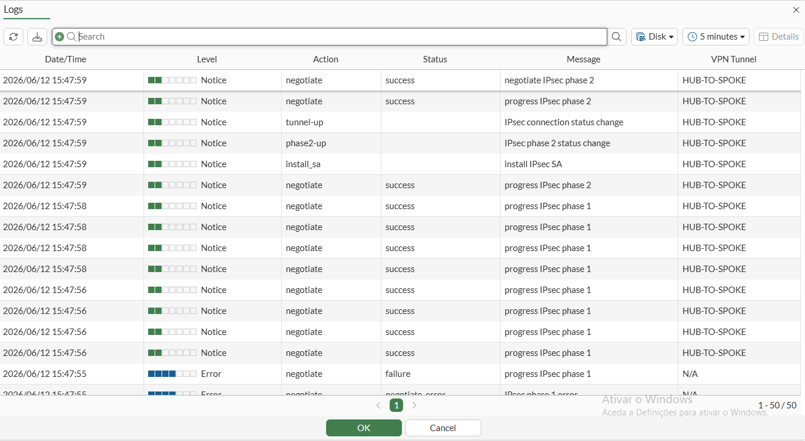
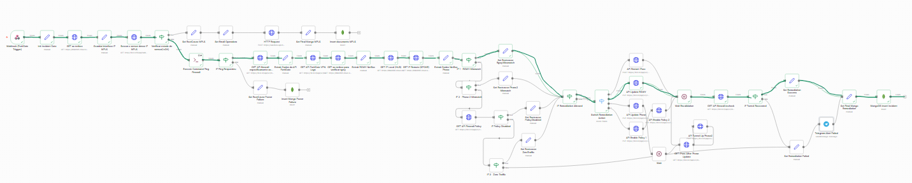
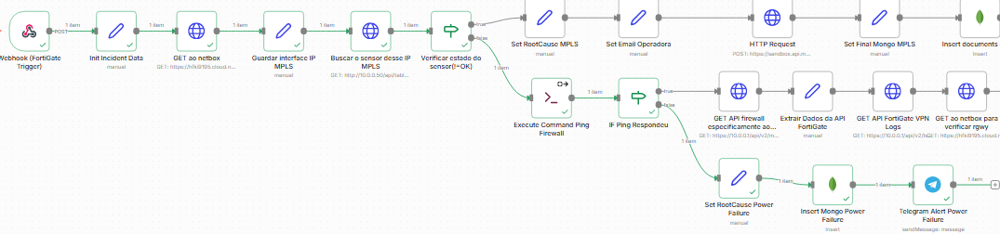
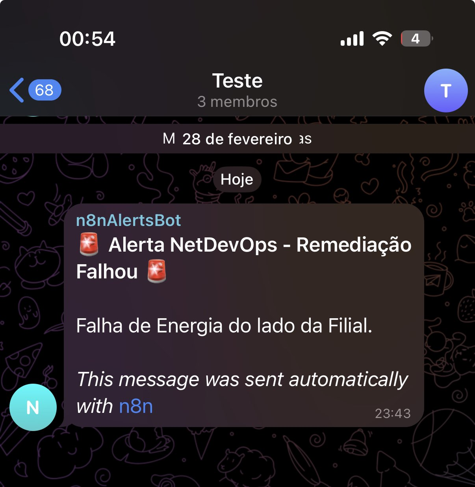
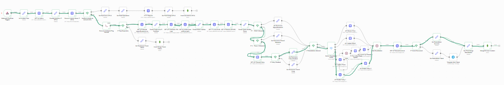

# 🧪 Empirical Lab Validation & Evidence Report (Projeto I & Projeto II)

> **Official Academic Title:** *Automação e Inteligência em Redes de Comunicação de Dados: integração da metodologia Network DevOps (NetDevOps), numa arquitetura de redes híbrida* (Projeto I — Feb 2026 | Projeto II — Jun 2026 · Final Grade: **19 / 20**)  
> **Authors:** Rafael Lourenço Cruz (Nº 20230326) & Rafael Ginga Victorino (Nº 20231475)  
> **Partner Institution:** **ARTE, I.P. — Agência para a Reforma Tecnológica do Estado, I.P.** (Decreto-Lei n.º 96/2025, ex-AMA)  
> **Industry Mentorship:** Eng.º Nuno Batuca (Equipa de Comunicações, ARTE, I.P.)  
> **Academic Supervisors:** Prof. Doutor Vasco Nuno da Gama de Jesus Soares (Orientador) & Prof. Doutor Alexandre José Pereira Duro da Fonte (Coorientador) — *EST/IPCB*  
> **Evaluation Jury:** Prof. Doutor Osvaldo Arede dos Santos (Presidente), Prof. Doutor Carlos Manuel de Oliveira Alves (Arguente), Prof. Doutor Vasco Nuno da Gama de Jesus Soares (Orientador)

---

## 📌 1. Scope & Methodology Clarification

To ensure full technical transparency for network engineers and evaluators, this repository distinguishes clearly between two complementary artifacts:

1. **Empirical Lab Validation (Real VMware Workstation Pro Testbed — 10 Scenarios A–J & 24 Recorded Incidents):**  
   Live fault injection, differential telemetry, and autonomous closed-loop remediation executed on virtualized **FortiGate NGFW appliances (FortiOS v7.6.4)**, **PRTG Network Monitor**, **n8n**, **NetBox (SSoT/IPAM)**, **MongoDB**, and **Metabase BI** inside a segmented **VMware Workstation Pro** environment. Across the laboratory evaluation, **10 Chaos Engineering scenarios** (Scenarios **A–E** in Phase 1 and **F–J** in Phase 2) generated **24 real incident records** persisted in MongoDB (`13` in `incident_runs` + `11` in `incident_runs_enterprise`).
2. **Offline Synthetic Benchmark (`scripts/chaos_simulation_demo.py`):**  
   A standalone Python simulation script parameterized with the empirical timing baselines to model an extended 24-scenario taxonomy and seed local MongoDB/Metabase containers for demonstration without requiring a multi-VM hypervisor or commercial FortiOS licenses.

---

## 🏗️ 2. Virtualized Testbed Architecture & Network Segmentation

The laboratory testbed was migrated from Oracle VirtualBox to **VMware Workstation Pro (25H2)** to eliminate promiscuous-mode vSwitch packet loss on multi-interface FortiGate VMs (`FGT-VM64`), faithfully mirroring the Hub-and-Spoke hybrid WAN architecture connecting the central **ARTE, I.P. Data Center (HUB)** to a remote **Loja do Cidadão branch (SPOKE)**:

```text
+---------------------------------------------------------------------------------------+
|                              VMWARE WORKSTATION PRO TESTBED                           |
|                                                                                       |
|  +--------------------------+                          +---------------------------+  |
|  |      FortiGate HUB       |                          |      FortiGate SPOKE      |  |
|  |     FortiOS v7.6.4       |                          |      FortiOS v7.6.4       |  |
|  |                          |     VMnet4 (Overlay)     |                           |  |
|  |  port1: 10.10.10.1/30 ===|=== HUB-TO-SPOKE IPsec ===|=== port3: 10.10.10.2/30   |  |
|  |                          |     VMnet5 (Underlay)    |                           |  |
|  |  port3: 172.16.0.1/30 ---|--- Simulated MPLS WAN ---|--- port2: 172.16.0.2/30   |  |
|  |  port2: 10.0.0.1/24      |                          |    port1: 192.168.10.1/24 |  |
|  +------------+-------------+                          +-------------+-------------+  |
|               |                                                      |                |
|        VMnet2 (OOB LAN)                                       VMnet3 (Branch LAN)     |
|          10.0.0.0/24                                            192.168.10.0/24       |
|        +------+------+                                                                |
|        |             |                                                                |
|        v             v                                                                |
|  +-----------+ +----------------------------------------------------+                 |
|  | Windows   | | Ubuntu Server 24.04 LTS (10.0.0.60/24)             |                 |
|  | 10.0.0.50 | | - Docker Stack: n8n, MongoDB (27017), Metabase BI  |                 |
|  | - PRTG    | | - NetBox SSoT/IPAM                                 |                 |
|  |   Monitor | | - Isolated Python venv (/opt/venv_netmiko PEP 668) |                 |
|  +-----------+ +----------------------------------------------------+                 |
+---------------------------------------------------------------------------------------+
```

### Interface, VMnet & Routing Matrix (Report Table 1 & Table 3)
* **VMnet2 — Out-of-Band Management LAN (`10.0.0.0/24`):** Isolates control-plane traffic so orchestration remains reachable even during total data-plane collapse. Hosts `FGT-HUB port2` (`10.0.0.1/24`), Windows PRTG Server (`10.0.0.50/24`), and Ubuntu Server 24.04 LTS (`10.0.0.60/24`).
* **VMnet5 — Underlay MPLS Transport (`172.16.0.0/30`):** Point-to-point simulated carrier circuit connecting `FGT-HUB port3` (`172.16.0.1/30`) to `FGT-SPOKE port2` (`172.16.0.2/30`).
* **VMnet4 — Overlay IPsec Endpoints (`10.10.10.0/30`):** Point-to-point tunnel interfaces (`HUB-TO-SPOKE` on `10.10.10.1/30` ↔ `SPOKE-TO-HUB` on `10.10.10.2/30`), parameterized with **IKEv2**, Pre-Shared Key, **AES128/AES256-SHA256 & AES-GCM (PRFSHA256/384)**, **Diffie-Hellman Group 20**, and **DPD On-Demand**.
* **VMnet3 — Remote Branch LAN (`192.168.10.0/24`):** Emulates the local network of a *Loja do Cidadão* behind `FGT-SPOKE port1` (`192.168.10.1/24`), reached via symmetric static routes (Administrative Distance `10`).

---

## 📈 3. Evolutionary Architecture: From Projeto I to Projeto II

| Operational Dimension | Projeto I (Feb 2026 — Passive Diagnostics) | Projeto II · Phase 1 (Trial / SSH Fallback) | Projeto II · Phase 2 (Enterprise / Native REST API) |
| :--- | :--- | :--- | :--- |
| **Primary Objective** | Minimize **MTTD** (< 10s, >95% reduction) | Active **MTTR** reduction via CLI scripts | Sub-second **CMDB REST API** self-healing |
| **Trigger Mechanism** | 4s/10s cyclic HTTP polling to PRTG API | Conditional PRTG polling (10s window) | Real-time **PRTG HTTP Webhooks** (< 1s MTTD) |
| **Hardware Pre-Check** | None (Underlay MPLS check only) | **ICMP Pre-Check** (`exitCode` on `172.16.0.2`) | **ICMP Pre-Check** + carrier sensor correlation |
| **Remediation Channel** | Read-only (`HTTP GET`) | **Python + Netmiko SSH** (`/opt/venv_netmiko`) | Synchronous **HTTPS PUT/POST** to FortiOS CMDB |
| **Authentication** | API Read Token | Administrative SSH credentials in lab scripts | **REST API Bearer Token + Trusted Hosts (`10.0.0.60`)** |
| **Isolated Root Causes** | 4 (`mpls_down`, `phase2`, `rgwy`, `zero_traffic`) | 5 (+ `power_or_hardware_failure`) | **5 (+ `policy_disabled` on Firewall Policies 1 & 2)** |
| **Audit & BI Layer** | Unidirectional Telegram notifications | MongoDB (`incident_runs` — **13 incidents**) | MongoDB (`incident_runs_enterprise` — **11 incidents**) + **Metabase BI** |

---

## 🔬 4. Empirical Chaos Engineering Trials (10 Scenarios A–J)

### Phase 1: Trial Environment & Netmiko SSH Contingency (Scenarios A–E)
Because FortiGate-VM evaluation (Trial) licenses block HTTP write verbs (`POST`/`PUT`/`PATCH`) on the REST API, Phase 1 implements an out-of-band SSH contingency engine using **Python 3** and **Netmiko** isolated inside `/opt/venv_netmiko` in strict compliance with **Ubuntu 24.04 PEP 668**.

#### Scenario A: Underlay MPLS Carrier Outage (`mpls_down`)
* **Injected Fault:** Administrative disconnection of `VMnet5` (`172.16.0.0/30`), dropping the physical MPLS link between HUB `port3` and SPOKE `port2`.
* **Closed-Loop Action:** n8n queries NetBox SSoT for the MPLS circuit IP, checks the corresponding PRTG sensor, confirms an external carrier outage, **aborts all firewall write operations**, dispatches an automated SMTP ticket to the telecom operator (captured in **Mailtrap**), and records `finalState: "escalated_to_provider"` in MongoDB.

#### Scenario B: Phase 2 Proxy-ID Configuration Drift (`phase2_mismatch`)
* **Injected Fault:** Manual corruption of Phase 2 traffic selectors on the SPOKE to `192.168.99.0/24` (diverging from the canonical `192.168.10.0/24` block in NetBox).
* **Closed-Loop Action:** After passing the ICMP Pre-Check (`exitCode == 0`), n8n detects the selector mismatch against NetBox and invokes `remediate_phase2.py` (which translates CIDR notation via Python's `ipaddress` library, injects `set src-subnet` / `set dst-subnet` via Netmiko SSH, clears Phase 1 SAs, and brings Phase 2 up).
* **FortiOS Syslog Verification (Report Figure 36):** Initial Phase 2 negotiation failure logged at `15:57:41`. The Netmiko script completed CLI injection and SA purge (`delete_phase1_sa` / `tunnel-down`) at **`15:58:23`**, triggered IKE renegotiation at **`15:58:24`**, and achieved full data-plane convergence (`install_sa`, `phase2-up`, `tunnel-up`) at **`15:58:30`** (**7.0 seconds active convergence**).

#### Scenario C: Silent Cryptographic Stall / Zombie Tunnel (`zero_traffic`)
* **Injected Fault:** Tunnel administratively `UP` with valid configuration in NetBox, but data-plane traffic stalled (`incoming_bytes == 0` and `outgoing_bytes == 0`).
* **Closed-Loop Action:** Exhausting IF 1 (Gateway) and IF 2 (Phase 2), the cascade classifies `zero_traffic` and executes `remediate_tunnel.py` (`diagnose vpn ike gateway clear name HUB-TO-SPOKE`).
* **FortiOS Syslog Verification (Report Section 3.2.1):** CLI SA purge (`delete_phase1_sa` / `tunnel-down`) logged at **`15:40:43`**, Phase 1 IKE renegotiation started at **`15:40:44`**, and `install_sa`, `phase2-up`, `tunnel-up` completed at **`15:40:50`** (**7.0 seconds active convergence**).

#### Scenario D: Phase 1 Remote Gateway Configuration Drift (`rgwy_mismatch`)
* **Injected Fault:** The HUB Phase 1 `remote-gw` parameter was altered to an invalid IP (`1.1.1.1`) instead of the SPOKE WAN IP (`172.16.0.2` in NetBox).
* **Closed-Loop Action:** Pre-Check ICMP to `172.16.0.2` returns `exitCode == 0`. n8n compares the FortiOS `remote-gw` (`1.1.1.1`) against NetBox (`172.16.0.2`), isolates `rgwy_mismatch`, and runs `remediate_config.py` via Netmiko SSH followed by a 12-second stabilization wait.
* **FortiOS Syslog Verification (Report Figure 38 — **4.0s Active Convergence**):**
  - **`15:47:55`** — `Error | negotiate | failure | progress IPsec phase 1`: Tunnel negotiation blocked by invalid gateway IP.
  - **`15:47:56`** — `Notice | negotiate | success | progress IPsec phase 1`: `remediate_config.py` restores `172.16.0.2` and IKEv2 negotiation succeeds immediately.
  - **`15:47:59`** — `Notice | install_sa / phase2-up / tunnel-up`: Security Association installed and IPsec tunnel fully restored in **4.0 seconds**.


*Figure 1 (Report Fig. 38): FortiGate HUB syslog console proving 4.0-second recovery (15:47:55 to 15:47:59) during Scenario D (`rgwy_mismatch`).*


*Figure 2 (Report Fig. 37): Active n8n execution trace isolating and remediating `rgwy_mismatch`.*

#### Scenario E: Branch Power Outage / Hardware Unreachability (`power_or_hardware_failure`)
* **Injected Fault:** Forced `Power Off` of the `FortiGate SPOKE` virtual machine while keeping the `VMnet5` MPLS switch active.
* **Closed-Loop Action:** MPLS sensor reports `OK`, but the Ubuntu Server shell **Pre-Check ICMP** probe (`3 packets, 1s RTO`) to `172.16.0.2` fails with `exitCode == 1`. The orchestrator immediately aborts all SSH/API connections to prevent management-plane timeouts and logs `power_or_hardware_failure` in MongoDB.


*Figure 3 (Report Fig. 39): n8n workflow diverting to the `power_or_hardware_failure` branch when Pre-Check ICMP returns `exitCode != 0`.*

---

### Phase 2: Enterprise Environment & Native FortiOS REST API (Scenarios F–J)
With commercial FortiGate licenses provided by **ARTE, I.P.**, Phase 2 replaces CLI terminal emulation with synchronous **HTTPS `PUT`/`POST` requests** directly against the FortiOS CMDB (`/api/v2/cmdb/`), secured via **API Tokens + Trusted Hosts (`10.0.0.60`)** and triggered in real time by **PRTG Webhooks** (achieving transactional efficiency $\mathcal{R}_{\text{trans}} \ge 90\%$ with CMDB write execution under **2 seconds**).

#### Scenario F: External Underlay MPLS Outage via Webhook (`mpls_down` — F2)
* **Injected Fault:** Disconnection of `VMnet5` MPLS transport under webhook-driven orchestration.
* **Closed-Loop Action:** PRTG fires an instant webhook to n8n; n8n verifies transport sensor `ID 2072 != OK`, blocks CMDB writes, sends an SMTP alert to the operator via Mailtrap, and logs `escalated_to_provider`.

#### Scenario G: Branch Power Outage with Instant ChatOps Alert (`power_or_hardware_failure` — F2)
* **Injected Fault:** Forced `Power Off` of the SPOKE VM under Phase 2 Enterprise workflow.
* **Closed-Loop Action:** Pre-Check ICMP fails (`exitCode != 0`), aborting REST API calls, recording the incident in `incident_runs_enterprise`, and dispatching an instant alert to the operations team on **Telegram**.


*Figure 4 (Report Fig. 42): Instant Telegram ChatOps notification alerting the engineering team of a branch power outage.*

#### Scenario H: Control-Plane Remote Gateway Drift via Native REST API (`rgwy_mismatch` — F2)
* **Injected Fault:** HUB Phase 1 `remote-gw` set to `1.1.1.1`.
* **Closed-Loop Action:** Node `IF 1 - RGWY Mismatch` detects the discrepancy against NetBox SSoT and triggers `API Update RGWY` (`HTTP PUT` to `/api/v2/cmdb/vpn.ipsec/phase1-interface/HUB-TO-SPOKE`), restoring the gateway atomically without SSH.

#### Scenario I: Data-Plane Phase 2 Selector Drift via Native REST API (`phase2_mismatch` — F2)
* **Injected Fault:** Corruption of Phase 2 CIDR selectors on the SPOKE.
* **Closed-Loop Action:** Node `IF 2 - Phase 2 Mismatch` catches the CIDR discrepancy against NetBox and executes `API Update Phase2` (`HTTP PUT` to `/api/v2/cmdb/vpn.ipsec/phase2-interface`) followed by synchronous tunnel bring-up.

#### Scenario J: Administrative Firewall Policy Disabling (`policy_disabled` — F2)
* **Injected Fault:** Security filtering policy `ID 2` (`SPOKE-to-LAN`) disabled in the FortiOS GUI, silently blackholing transit traffic despite active IKE/IPsec SAs.
* **Closed-Loop Action:** n8n audits `/api/v2/cmdb/firewall/policy/`, evaluates `IF Policy Disabled` (checking whether Policy ID 1 `LAN-to-SPOKE` or Policy ID 2 `SPOKE-to-LAN` is inactive), and executes the dual-PUT remediation (`API Enable Policy 1` & `API Enable Policy 2` with payload `{"status": "enable"}`), followed by a 35-second stabilization check and forensic log extraction into `incident_runs_enterprise`.


*Figure 5 (Report Fig. 45): Full n8n Phase 2 Enterprise canvas showing the active green execution path for `policy_disabled` ("Combo Duplo" REST API PUT remediation).*

---

## 📊 5. Complete 10-Scenario & 24-Incident Empirical Matrix (Report Table 7 & Section 3.3)

### Summary of All 10 Chaos Engineering Scenarios (A–J)

| Scenario | Phase | Injected Fault | Detected Root Cause | Remediation / Action Mechanism | Final MongoDB State |
| :--- | :---: | :--- | :--- | :--- | :--- |
| **Cenário A** | F1 (Trial) | `VMnet5` MPLS Link Down | `mpls_down` | Write abort + SMTP alert to carrier (Mailtrap) | `escalated_to_provider` |
| **Cenário B** | F1 (Trial) | Phase 2 CIDR Drift (`192.168.99.0/24`) | `phase2_mismatch` | **SSH Netmiko:** `remediate_phase2.py` (**7.0s** syslog convergence) | `auto_recovered` |
| **Cenário C** | F1 (Trial) | Silent Stall (`0 bytes` in/out) | `zero_traffic` | **SSH Netmiko:** `remediate_tunnel.py` (`ike gateway clear`, **7.0s** convergence) | `auto_recovered` |
| **Cenário D** | F1 (Trial) | Phase 1 Gateway Drift (`1.1.1.1`) | `rgwy_mismatch` | **SSH Netmiko:** `remediate_config.py` (**4.0s** syslog convergence) | `auto_recovered` |
| **Cenário E** | F1 (Trial) | SPOKE VM Power Off | `power_or_hardware_failure` | Pre-Check ICMP (`exitCode == 1`) → SSH abort | `power_or_hardware_failure` |
| **Cenário F** | F2 (Enterprise) | External MPLS Link Down (Sensor 2072) | `mpls_down` | Webhook trigger → CMDB write abort + SMTP Mailtrap | `escalated_to_provider` |
| **Cenário G** | F2 (Enterprise) | SPOKE VM Power Off | `power_or_hardware_failure` | Pre-Check ICMP (`exitCode != 0`) → API abort + Telegram alert | `power_or_hardware_failure` |
| **Cenário H** | F2 (Enterprise) | Phase 1 Gateway Drift (`1.1.1.1`) | `rgwy_mismatch` | **FortiOS REST API:** `HTTP PUT` CMDB (`API Update RGWY`, < 2s) | `auto_recovered` |
| **Cenário I** | F2 (Enterprise) | Phase 2 CIDR Selector Drift | `phase2_mismatch` | **FortiOS REST API:** `HTTP PUT` CMDB (`API Update Phase2` + bring-up) | `auto_recovered` |
| **Cenário J** | F2 (Enterprise) | Firewall Policy ID 2 Disabled | `policy_disabled` | **FortiOS REST API:** Dual `HTTP PUT {"status": "enable"}` on Policies 1 & 2 | `auto_recovered` |

### Distribution of the 24 Recorded Incidents in MongoDB & Metabase BI

1. **Collection 1 — `incident_runs` (Phase 1 Baseline: 13 Recorded Incidents, Report Figs. 47–53):**
   * **By Root Cause:** `mpls_down` (4 / **30.8%**), `rgwy_mismatch` (3 / **23.1%**), `phase2_mismatch` (2 / **15.4%**), `power_or_hardware_failure` (2 / **15.4%**), `zero_traffic` (2 / **15.4%**).
   * **By Outcome (`FinalState`):** **7 `auto_recovered` (53.8%)** — 100% of the 7 logical faults where `remediationAllowed == true`; **4 `escalated_to_provider` (30.8%)**; **2 `power_or_hardware_failure` (15.4%)**.
2. **Collection 2 — `incident_runs_enterprise` (Phase 2 Enterprise: 11 Recorded Incidents, Report Figs. 54–56):**
   * **By Root Cause:** `policy_disabled` (3 / **27.27%**), `rgwy_mismatch` (3 / **27.27%**), `phase2_mismatch` (2 / **18.18%**), `power_or_hardware_failure` (2 / **18.18%**), `mpls_down` (1 / **9.09%**).
   * **By Outcome (`remediationResult`):** **8 `Success` / `auto_recovered` (72.7%)** — 100% of the 8 logical faults eligible for self-healing; **3 `not_attempted` (27.3%)** — physical/external faults safely blocked by Pre-Check and underlay correlation.
3. **Combined Total:** **24 empirical incidents (`13 + 11`)** persisted in MongoDB and audited in Metabase BI.
