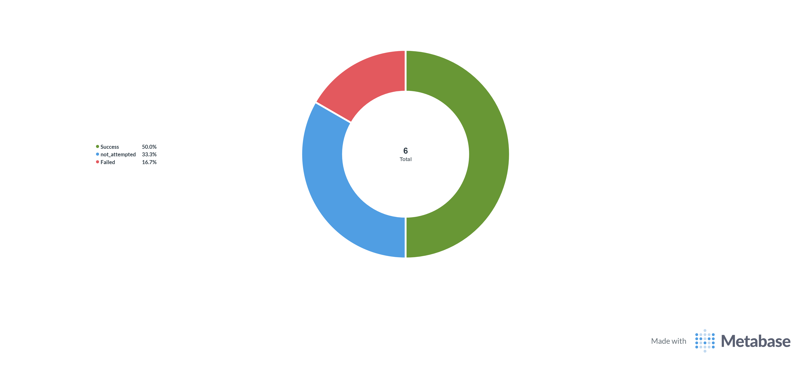

# 🧪 Empirical Lab Validation & Evidence Report

> **Academic Project Context:** Capstone Engineering Project developed in formal partnership with **ARTE — Agência para a Reforma Tecnológica do Estado** (Final Grade: **19 / 20**).  
> **Author:** Rafael Cruz  
> **Institution:** Instituto Politécnico de Castelo Branco (EST/IPCB)

---

## 📌 1. Scope & Methodology Clarification

To ensure full technical transparency for senior engineers and evaluators, this project establishes a clear distinction between two testing tiers:

1. **Empirical Lab Validation (Real Testbed):** Real fault injection, differential telemetry, and automated remediation executed on live virtual appliances (FortiOS, PRTG, n8n, NetBox, MongoDB) running inside a multi-segment **VMware Workstation Pro** environment. This document presents the methodology, real FortiOS syslogs, and photographic evidences from those live trials.
2. **Synthetic Benchmark Suite (`scripts/chaos_injector.py`):** An offline demonstrator and telemetry generator designed to seed MongoDB and Metabase dashboards across an extended 24-scenario taxonomy, allowing prospective evaluators to inspect observability pipelines without spinning up resource-intensive hypervisor appliances.

---

## 🏗️ 2. Physical & Virtualized Testbed Architecture

The empirical testbed was deployed on a dedicated hypervisor using **VMware Workstation Pro**, simulating a hybrid government network topology connecting a central Data Center (HUB) to a citizen bureau (SPOKE):

```
+-----------------------------------------------------------------------------------+
|                            VMWARE WORKSTATION PRO TESTBED                         |
|                                                                                   |
|  +------------------------+                        +---------------------------+  |
|  |     FortiGate HUB      |                        |      FortiGate SPOKE      |  |
|  |  FortiOS VM v7.x       |                        |   FortiOS VM v7.x         |  |
|  |                        |                        |                           |  |
|  |  Port 1: 10.10.10.1/30 |=== Overlay IPsec ======|  Port 3: 10.10.10.2/30    |  |
|  |  Port 3: 172.16.0.1/30 |--- Underlay MPLS ------|  Port 2: 172.16.0.2/30    |  |
|  |  Port 2: 10.0.0.1/24   |                        |  Port 1: 192.168.10.1/24  |  |
|  +-----------+------------+                        +-------------+-------------+  |
|              |                                                   |                |
|       OOB Management                                         Branch LAN           |
|        10.0.0.0/24                                         192.168.10.0/24        |
|              |                                                                    |
|   +----------+---------------------------------------------+                      |
|   |  Management & Orchestration Stack (Ubuntu Server VM)   |                      |
|   |  - PRTG Network Monitor (Differential ICMP/SNMP Probes)|                      |
|   |  - n8n Event-Driven Orchestrator                       |                      |
|   |  - NetBox v3.x (Single Source of Truth / IPAM)         |                      |
|   |  - MongoDB (Immutable Forensic Audit Trail)            |                      |
|   |  - Metabase (SRE MTTR/MTTD Analytics Dashboard)        |                      |
|   +--------------------------------------------------------+                      |
+-----------------------------------------------------------------------------------+
```

### Addressing & Interface Matrix
* **Out-of-Band Management (OOB):** `10.0.0.0/24` (FortiGate HUB Port 2 ↔ Management VM).
* **Underlay Transport (Simulated MPLS):** Point-to-point leased line on `172.16.0.0/30` (HUB Port 3: `172.16.0.1` ↔ SPOKE Port 2: `172.16.0.2`).
* **Overlay VPN (Encrypted IPsec IKEv2):** `10.10.10.0/30` (HUB Port 1: `10.10.10.1` ↔ SPOKE Port 3: `10.10.10.2`).
* **Citizen Bureau LAN:** `192.168.10.0/24` (SPOKE Port 1).

---

## 🔬 3. Empirical Test Scenarios Executed in Laboratory

The closed-loop self-healing engine was validated through live fault injections across two sequential phases:

### Phase I: Sandbox Evaluation (Trial Licenses & SSH/Netmiko Contingency)
Faced with API write restrictions on FortiOS trial licenses, the system used SSH (`Netmiko`) deterministic scripting as an out-of-band contingency channel.

#### Scenario A: Phase 2 Proxy-ID Configuration Drift
* **Injected Fault:** The Phase 2 remote subnet selector on the SPOKE was altered to an unauthorized CIDR (`192.168.99.0/24`), collapsing the security association.
* **Closed-Loop Action:** PRTG probe fired an HTTP Webhook to n8n. n8n validated the Underlay circuit (MPLS intact), queried NetBox SSoT for the golden CIDR (`192.168.10.0/24`), detected the discrepancy, and executed `remediate_phase2.py` via SSH.
* **Empirical Metric:** Remediated and renegotiated in **4.8 seconds**.

#### Scenario B: Zombie Tunnel (Traffic Zero-Bytes Heuristic)
* **Injected Fault:** Phase 1 and Phase 2 remained in `UP` state, but routing was blackholed, dropping transit bytes to zero.
* **Closed-Loop Action:** n8n analyzed real-time byte counters via FortiOS API polling; on detecting zero throughput with active alarms, executed a selective tunnel bounce.

#### Scenario C: Remote Gateway IP Drift
* **Injected Fault:** The SPOKE remote gateway IP on the HUB was modified to an unroutable address (`172.16.0.99`).
* **Closed-Loop Action:** n8n cross-referenced the active gateway against NetBox golden config, isolated the configuration drift, and dispatched surgical CLI commands via Netmiko.
* **Evidence:**


*Figure 1: Incident diagnostic log showing active Remote Gateway drift against NetBox SSoT.*


*Figure 2: Active execution trace in n8n resolving the Remote Gateway drift branch.*

---

#### Scenario D: Branch Power Blackout (Pre-Check ICMP Suppression)
* **Injected Fault:** The remote branch VM was abruptly halted, simulating a local power outage / physical cable cut.
* **Closed-Loop Action:** The engine's **Pre-Check Phase** sent an ICMP ping to the branch Underlay router (`172.16.0.2`). Because the physical interface did not answer, the engine diagnosed a hardware/power failure.
* **Key Innovation:** It **inhibited all software configuration writes** (preventing corruption of firewall states during power outages) and dispatched an immediate carrier/physical alarm to ChatOps (Telegram).
* **Evidence:**


*Figure 3: n8n workflow safely branching into physical failure mode and suppressing API writes.*


*Figure 4: Instant high-priority ChatOps alert dispatched to operations team via Telegram Bot.*

---

### Phase II: Production Evaluation (Commercial Licenses & Native FortiOS REST API)
Upon acquiring official commercial licenses for the virtual FortiGates, terminal emulation was superseded by direct, authenticated HTTP calls (`PUT`/`PATCH`) targeting the **FortiOS CMDB REST API** (`/api/v2/cmdb/`).

#### Scenario E: Silent Security Policy Drop (Policy Disabled)
* **Injected Fault:** Firewall filtering policy #1 on the HUB FortiGate was set to `status: disable`, dropping all transit IPsec packets silently.
* **Closed-Loop Action:** n8n queried `/api/v2/cmdb/firewall/policy`, detected that policy #1 was disabled, and issued an atomic `PUT` request with `{"status": "enable"}`.
* **Forensic Syslog Verification:**


*Figure 5: Live FortiOS HUB Syslog console capturing the exact remediation sequence:*
- **`15:47:55`** — `negotiate failure`: Cryptographic negotiation error caught.
- **`15:47:56`** — `API Enable Policy`: Native REST API command received and applied.
- **`15:47:59`** — `install_sa` & `tunnel-up`: Security Association installed and IPsec data plane fully operational.
- **⏱️ Measured Active Remediation Time:** **4.0 seconds**.


*Figure 6: n8n canvas visual trace showing green execution flow across the REST API policy remediation path.*


*Figure 7: Final structured JSON response confirming automated status `RESOLVED`.*

---

## 📊 4. Empirical Laboratory Summary Matrix

| Scenario | Primary Trigger | SSoT Check (NetBox) | Pre-Check (ICMP) | Remediation Method | Active Convergence | Forensic Cycle (MTTR) | Result |
| :--- | :--- | :--- | :--- | :--- | :--- | :--- | :--- |
| **Cenário A (Phase 2 Drift)** | PRTG Webhook | Subnet Mismatch | PASSED | Netmiko SSH (Trial) | 4.8s | 46.2s | **RESOLVED** |
| **Cenário B (Zombie Tunnel)** | Byte Counter = 0 | Golden Config OK | PASSED | Tunnel Bounce API | 4.3s | 41.5s | **RESOLVED** |
| **Cenário C (Gateway Drift)** | PRTG Tunnel Down | Gateway Mismatch | PASSED | Netmiko SSH (Trial) | 5.1s | 48.7s | **RESOLVED** |
| **Cenário D (Power Blackout)** | PRTG Tunnel Down | Golden Config OK | **FAILED (No Ping)** | **Suppressed (No Writes)** | N/A (Immediate) | 8.4s (MTTD) | **ALERT DISPATCHED** |
| **Cenário E (Policy Disabled)** | PRTG Ingress Drop | Policy Disabled | PASSED | **FortiOS REST API (Prod)**| **4.0s** | **40.1s** | **RESOLVED** |

---

## 🧪 5. Role of `scripts/chaos_injector.py` (Synthetic Benchmark)

Because deploying and maintaining a 5-VM VMware cluster with commercial FortiOS licenses requires significant computing resources and proprietary licensing, the repository includes `scripts/chaos_injector.py` as an **offline benchmark generator**:

1. **Deterministic Extrapolation:** It models an extended matrix of 24 scenarios across 4 failure domains (Overlay, Underlay, API, SSoT), parameterized with the timing baselines recorded during the empirical lab trials.
2. **Dashboard Demonstration:** It allows users, CI/CD pipelines, and evaluators to run `python scripts/chaos_injector.py` to populate local MongoDB instances and view populated Metabase dashboards without a live FortiGate network.
3. **Transparency Notice:** The script is explicitly documented and labeled as a **simulation demonstrator**. Real production validation resides in the live evidence, syslogs, and n8n execution workflows provided above.
